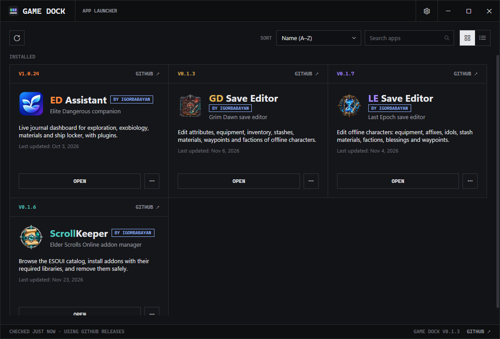
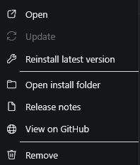
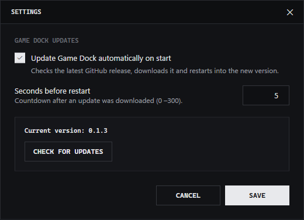

# Game Dock

**A unified launcher for gaming companion apps, save editors, and utilities.**

Install, launch, update, and manage your gaming tools from one place.

## Overview

Game Dock brings a collection of standalone gaming utilities together in a single desktop application. Instead of manually visiting multiple repositories to manage your tools, you can access your installed applications, check their versions, and manage updates through a unified interface powered by GitHub Releases.

## Screenshots

### Application dashboard

Browse installed applications, view their versions and descriptions, search and sort your collection, and switch between grid and list layouts.

### Application management

| Application actions | Update settings |
| :---: | :---: |
|  |  |

## Features

- **Unified application launcher** — open your gaming utilities directly from Game Dock.
- **Application installation and management** — install, update, reinstall, and remove supported applications.
- **GitHub Releases integration** — check for available releases and access their release notes.
- **Automatic self-updates** — optionally update Game Dock automatically on startup.
- **Configurable restart countdown** — choose a delay between 0 and 300 seconds before restarting after a Game Dock update.
- **Grid and list views** — switch between visual application cards and a compact list.
- **Search and sorting** — quickly find applications and organize your collection.
- **Version tracking** — view application versions and last updated dates.
- **Quick access** — open installation folders and visit application repositories.
- **Dark interface** — a consistent, minimal desktop design.

## Supported applications

| Application | Game | Description |
| --- | --- | --- |
| [ED Assistant](https://github.com/IgorBabayan/ed-assistant) | Elite Dangerous | Live journal dashboard for exploration, exobiology, materials, and ship locker, with plugin support. |
| [GD Save Editor](https://github.com/IgorBabayan/gd-save-editor) | Grim Dawn | Edit offline character attributes, equipment, inventory, stashes, materials, waypoints, and factions. |
| [LE Save Editor](https://github.com/IgorBabayan/le-save-editor) | Last Epoch | Edit offline characters, equipment, affixes, idols, stash materials, factions, blessings, and waypoints. |
| [ScrollKeeper](https://github.com/IgorBabayan/scroll-keepers) | The Elder Scrolls Online | Browse the ESOUI catalog, install addons and required libraries, and safely remove addons. |

Each application is maintained independently. Visit its repository for documentation, compatibility information, and issue reporting.

## Getting started

### Installation

1. Open the **Releases** section of this repository.
2. Select the latest available release.
3. Download the appropriate Windows release asset.
4. Install or extract the application as appropriate for the downloaded package, then launch Game Dock.

An internet connection is required to retrieve release information and download applications or updates.

### Managing applications

Use the application dashboard to browse and launch your tools. Open the three-dot menu on an application card to access additional actions:

| Action | Description |
| --- | --- |
| Open | Launch the installed application. |
| Update | Install a newer version when one is available. |
| Reinstall latest version | Reinstall the latest available release. |
| Open install folder | Access the application's installation directory. |
| Release notes | View information about the release. |
| View on GitHub | Open the application's GitHub repository. |
| Remove | Remove the installed application. |

## Automatic updates

Game Dock uses GitHub Releases to check for updates to the launcher itself.

To configure automatic updates:

1. Open **Settings** using the gear icon in the title bar.
2. Enable **Update Game Dock automatically on start**.
3. Set **Seconds before restart** to your preferred value (0–300 seconds).
4. Click **Save**.

When automatic updates are enabled, Game Dock checks for a newer release on startup, downloads it when available, and restarts into the new version after the configured countdown.

You can also use **Check for updates** in Settings to initiate a manual check. Updates for managed applications can be accessed through their individual application menus.

## Feedback and contributions

Bug reports, feature requests, and suggestions are welcome. Please use the **Issues** section of this repository and include your Game Dock version, operating system, steps to reproduce the problem, and relevant screenshots or error messages when applicable.

If an issue is specific to a managed application, please report it in that application's repository.

## Disclaimer

Game Dock and its managed utilities are independent community projects and are not affiliated with or endorsed by the publishers or developers of the games they support. All game names and trademarks belong to their respective owners.

Save editors modify game data. Always back up your save files before making changes and follow the relevant game's rules and terms of service.

---

Developed by [IgorBabayan](https://github.com/IgorBabayan).

If you find Game Dock useful, consider giving this repository a star!

